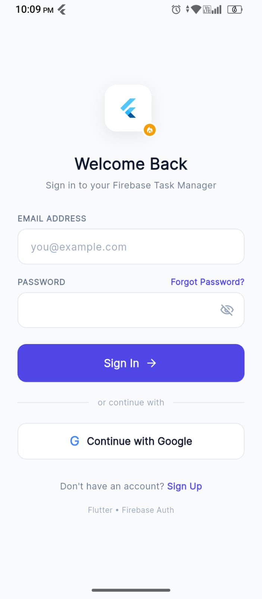
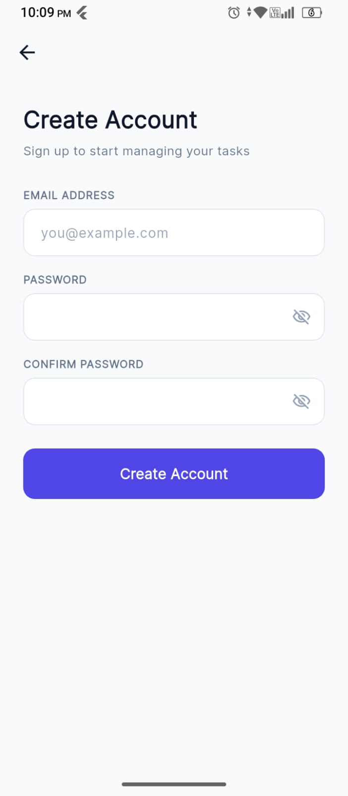
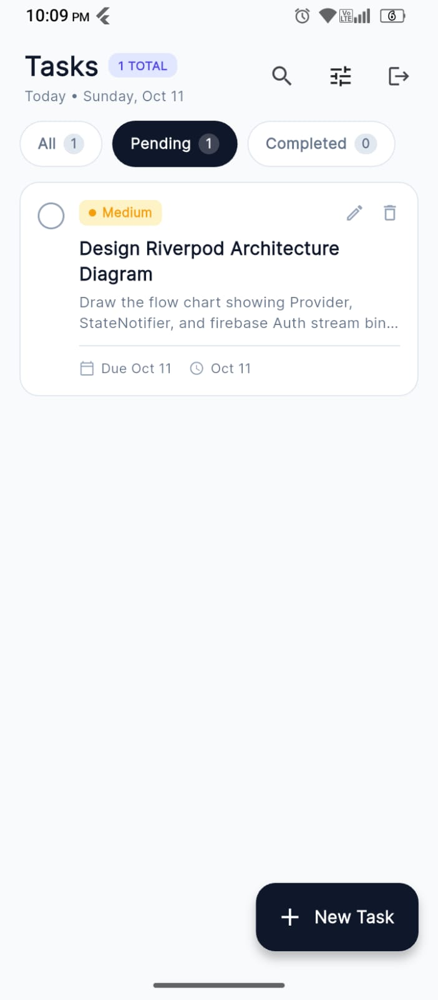
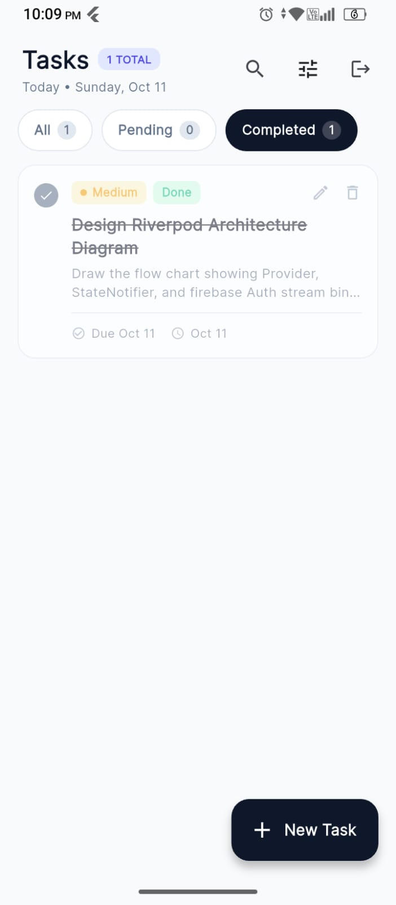
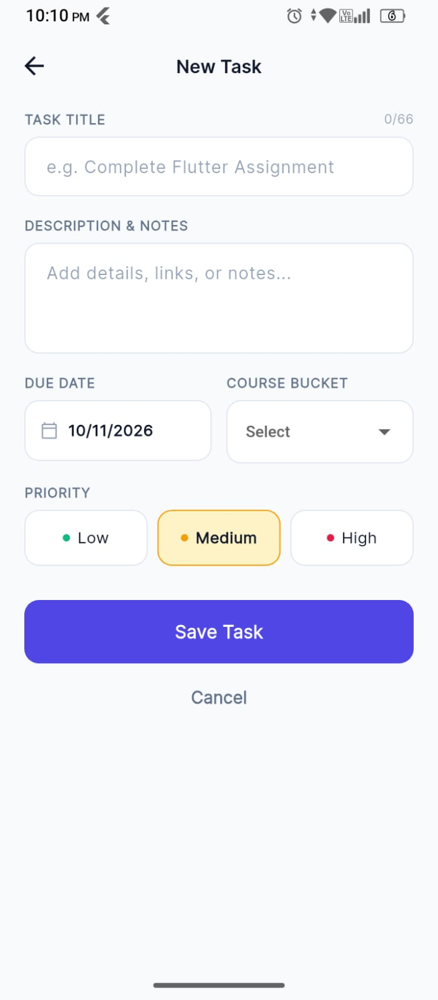
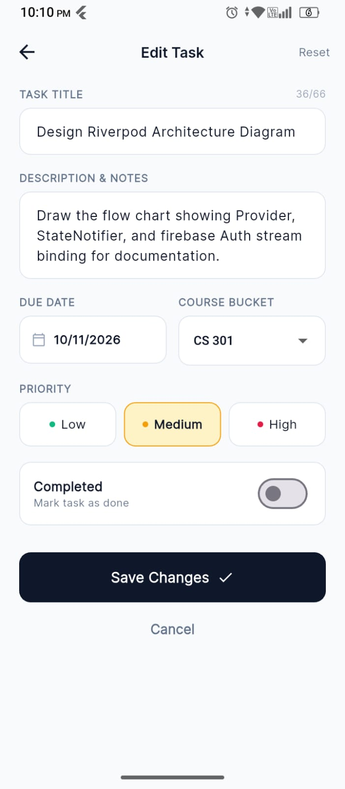
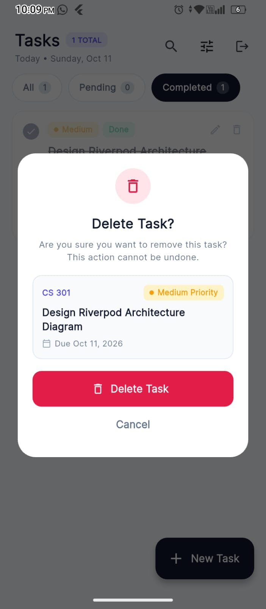
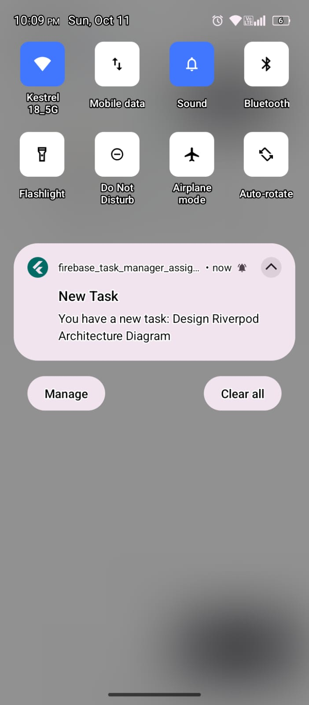

<div align="center">

# 📝 Firebase Task Manager App

An enterprise-grade, state-aware Task Management application built using **Flutter** and **Riverpod**, powered by **Firebase Core**, **Authentication**, **Cloud Firestore**, and **FCM + Local Notifications**.


</div>

---

## 📌 Project Overview

This assignment project demonstrates a robust implementation of modern Flutter development practices. It provides complete Task Management (CRUD) capabilities synchronized in real-time with **Cloud Firestore**, backed by secure **Firebase Authentication** (Email/Password & Google Sign-In), and features a comprehensive multi-state notification system handling **FCM Push Notifications** and **Local Notifications**.

---

## ✨ Key Features & Highlights

### 🔐 Authentication & Authorization
- **Email & Password Auth:** Full registration and sign-in flow with error handling.
- **Google Sign-In:** One-tap OAuth integration for effortless access.
- **Reactive Auth State:** Real-time stream listening via Riverpod providers (`auth_gate.dart`, `session_listener.dart`).

### 📋 Task Management (Firestore CRUD)
- **Real-Time Data Sync:** Live state updates for tasks powered by Cloud Firestore.
- **Complete Task Metadata:** Title, Description, Due Date, Priority (High / Medium / Low), Buckets, and Completion Status.
- **Dynamic Filtering & Sorting:** Instant switching between *Pending* and *Completed* task lists with priority and date sorting.
- **Live Search:** Fast, real-time search by task title or description.
- **Delete Guard:** Modal confirmation dialog (`delete_task_dialog.dart`) before performing permanent deletion.

### 🔔 Advanced State-Aware Notifications
- **Firebase Cloud Messaging (FCM):** Topic-based broadcast (`all_tasks`) and direct payload messaging.
- **Foreground Local Notifications:** Auto-converts incoming FCM payloads into heads-up local notifications using `flutter_local_notifications`.
- **Full Lifecycle Handling:**
   - 🟢 **Foreground:** Shows immediate banner notification.
   - 🟡 **Background:** Handled natively by OS & Firebase background handler (`fcm_background_handler.dart`).
   - 🔴 **Terminated:** Deep-links directly into the task editor upon user tap via global router (`notification_router.dart`).

---

## 📱 App Screenshots

<div align="center">

| Login Screen | Sign Up Screen | Task List (Pending) | Task List (Completed) |
| :---: | :---: | :---: | :---: |
|  |  |  |  |

| New Task Form | Edit Task Screen | Delete Dialog | Push Notification |
| :---: | :---: | :---: | :---: |
|  |  |  |  |

</div>

---

## 🛠️ Tech Stack & Key Packages

| Category | Technology / Package | Purpose |
| :--- | :--- | :--- |
| **Framework** | [Flutter](https://flutter.dev) | Cross-platform UI Toolkit |
| **Language** | [Dart](https://dart.dev) | Client-optimized language |
| **State Management** | [`flutter_riverpod`](https://pub.dev/packages/flutter_riverpod) | Reactive & compile-safe state management |
| **Authentication** | [`firebase_auth`](https://pub.dev/packages/firebase_auth) & [`google_sign_in`](https://pub.dev/packages/google_sign_in) | Firebase User Management & OAuth |
| **Database** | [`cloud_firestore`](https://pub.dev/packages/cloud_firestore) | NoSQL real-time cloud storage |
| **Push Messaging** | [`firebase_messaging`](https://pub.dev/packages/firebase_messaging) | Remote push notification service |
| **Local Alerts** | [`flutter_local_notifications`](https://pub.dev/packages/flutter_local_notifications) | Foreground heads-up banners & alerts |

---

## 📂 Architecture & Project Structure

```text
lib/
├── app.dart                            # Global MaterialApp & Routing config
├── firebase_options.dart               # Auto-generated Firebase configuration
├── main.dart                           # App entry point, FCM & Local Notification setup
│
├── core/                               # Core Utilities & App Configuration
│   ├── app_colors.dart                 # Color palette & Material 3 bindings
│   ├── app_exception.dart              # Custom exception models
│   ├── app_theme.dart                  # Light / Dark theme setup
│   ├── date_formatter.dart             # Date formatting helpers
│   ├── navigator_key.dart              # Global Navigation key for context-free routing
│   ├── safe_call.dart                  # Async execution wrapper
│   ├── snackbar.dart                   # Toast & alert helpers
│   └── validators.dart                 # Form field validators
│
├── models/                             # Data Models & Entities
│   ├── task_buckets.dart               # Task category buckets
│   ├── task_filter.dart                # Filter enum (Pending, Completed, All)
│   ├── task_model.dart                 # Main Task Entity model with Firestore converters
│   ├── task_priority.dart              # Priority levels (High, Medium, Low)
│   └── task_sort.dart                  # Task sorting configurations
│
├── providers/                          # Riverpod State Providers
│   ├── auth_providers.dart             # Auth state & user session streams
│   ├── firebase_providers.dart         # Core Firebase instance singletons
│   ├── service_providers.dart          # FCM & Local Notification providers
│   └── task_providers.dart             # Firestore Task CRUD notifier & filter state
│
├── screens/                            # User Interface Views
│   ├── auth_gate.dart                  # Auth route switcher
│   ├── login_screen.dart               # Login & Google Sign-In view
│   ├── sign_up_screen.dart             # User Registration view
│   ├── splash_screen.dart              # App startup screen
│   ├── task_form_screen.dart           # Add / Edit task modal view
│   └── task_list_screen.dart           # Dashboard with Filter, Search & List
│
├── services/                           # External Backend & Platform Services
│   ├── auth_error_messages.dart        # FirebaseAuth exception translator
│   ├── auth_service.dart               # Email/Password & Google Sign-In logic
│   ├── fcm_background_handler.dart     # Top-level FCM background/terminated callback
│   ├── fcm_service.dart                # FCM setup & stream listeners
│   ├── fcm_token_service.dart          # Device FCM Token retriever
│   ├── local_notification_service.dart # Heads-up notification channel manager
│   ├── notification_router.dart        # Deep-linking routing on notification tap
│   ├── notification_styles.dart        # Notification priority visual styling
│   └── task_service.dart               # Firestore database interaction queries
│
└── widgets/                            # Reusable UI Components
    ├── app_logo.dart                   # Branding logo widget
    ├── app_text_field.dart             # Styled input text fields
    ├── bucket_dropdown.dart            # Category bucket selector
    ├── completed_switch.dart           # Task completion toggle
    ├── delete_task_dialog.dart         # Deletion confirmation dialog
    ├── due_date_field.dart             # Date picker input field
    ├── empty_tasks_view.dart           # Empty state visual placeholder
    ├── google_button.dart              # Google OAuth button
    ├── or_divider.dart                 # UI divider with text
    ├── password_field.dart             # Secure password text field
    ├── primary_button.dart             # Action call-to-action button
    ├── priority_selector.dart          # High/Medium/Low priority selector
    ├── priority_style.dart             # Priority styling helpers
    ├── priority_tag.dart               # Visual badge for task priority
    ├── section_label.dart              # Header labels
    ├── session_listener.dart           # Auth stream session observer
    ├── task_card.dart                  # Main Task item list card
    ├── task_filter_tabs.dart           # Pending/Completed tab switcher
    ├── task_list_body.dart             # Task list container view
    └── task_list_header.dart           # Search bar & App title header